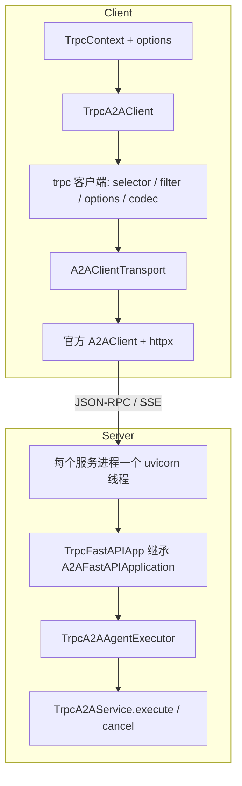

[中文](README.zh_CN.md) | English

# tRPC-A2A-Python

`tRPC-A2A-Python` is the trpc-python plugin for the **A2A (Agent2Agent)** protocol. It lets you implement and call Agents the trpc way (messages, tasks, streaming updates, and push notifications), and plugs A2A into trpc service governance.

In one line:

```text
trpc-a2a = official a2a-sdk (A2AFastAPIApplication / A2AClient) + trpc-python governance (selector / filter / options) + trpc_fastapi (FastAPI & uvicorn)
```

The server subclasses `TrpcA2AService` to implement an Agent and is hosted by the trpc server. The client calls it through `TrpcA2AClient`. JSON-RPC and SSE are still sent and received by the official a2a-sdk. The call path reuses trpc addressing, filters, and options, and the API stays aligned with the official SDK.

## Highlights

- **Native trpc experience**: the server implements `get_agent_card` / `execute` / `cancel` and starts with `create_server().serve()` after `register_service`. The client discovers the agent card by the service name in YAML and calls it.
- **Built on the official a2a-sdk**: the server is based on `A2AFastAPIApplication` and the client on `A2AClient`. Messages, tasks, SSE, the agent card (`/.well-known/agent-card.json`), official types, and the event queue are used the same way.
- **trpc service governance**: the client goes through selector, filter, and options (protocol / timeout / target). Server requests pass the server filter first. The JSON-RPC method is recorded as the rpc name, and protocol errors become `TrpcException` so filters can see them.
- **Tasks and push config can be shared**: task and push configuration live in process memory by default. Set `redis_name` to use Redis, so `tasks/get`, `tasks/cancel`, and push configuration can hit any process.
- **Custom HTTP on the same port**: `@fastapi_route` or `set_fastapi` mounts business routes on the same port. Handlers read the tRPC context with `get_trpc_ctx()`.
- **Streaming and push**: `send_message_streaming` / `resubscribe` use SSE. `pushNotifications` are sent by the official `TaskUpdater` as webhooks when status and artifacts update.

## Install and quick start

### Requirements

- Python `>=3.10` (3.12 recommended). Use a virtual environment to isolate dependencies.
- trpc-python SDK (the `trpc_sdk` package, PyPI name `trpc-python`). Windows is not supported.

### Install

```bash
pip install trpc-a2a
```

Dependencies: `trpc-python`, `trpc_fastapi`, `a2a-sdk>=0.3.5`, `fastapi`, `uvicorn`, and `httpx`.

To share tasks across processes, or to store push configuration in Redis, install the redis extra (`redis` and `trpc_redis`):

```bash
pip install 'trpc-a2a[redis]'
```

Without `redis_name`, storage stays in process memory and `trpc_redis` is not loaded. If `redis_name` is set, the matching client service exists, and the extra is not installed, startup raises `ImportError` and tells you to run the command above.

### Quick start

#### 1. Server: implement an Agent and start it

`trpc_python.yaml`:

```yaml
server:
  service:
    - name: trpc.a2a_test.test_a2a_agent
      protocol: a2a          # 协议固定为 a2a
      ip: 127.0.0.1          # 会写入 agent card 的 url，客户端按这个地址发 JSON-RPC
      port: 18080
      network: tcp
      # 如果需要使用 Redis，取消注释以下配置
      # redis_name: trpc.redis.test_example

# 如果需要使用 Redis，添加以下配置
# client:
#   service:
#     - name: trpc.redis.test_example
#       target: ip://127.0.0.1:6379
#       timeout: 5000
#       password: ${redis_password}  # 可选
#       redis:
#         db: 0
```

```python
# agents/echo_agent.py
from trpc_sdk.abc import TrpcContext

from a2a.server.events import EventQueue
from a2a.server.tasks import TaskUpdater
from a2a.types import AgentCapabilities, AgentCard, AgentSkill, Part, TaskState, TextPart
from a2a.utils import new_agent_text_message, new_task

from trpc_a2a.server import TrpcA2AService, get_a2a_request_context, register_service


class EchoAgentService(TrpcA2AService):
    async def get_agent_card(self) -> AgentCard:
        return AgentCard(
            name="Echo Agent",
            description="A simple echo agent",
            url="",  # 留空则填成上面的 ip:port
            version="1.0.0",
            default_input_modes=["text"],
            default_output_modes=["text"],
            capabilities=AgentCapabilities(streaming=False, pushNotifications=False),
            skills=[AgentSkill(id="echo", name="Echo", description="Echo the user text", tags=["echo"])],
        )

    async def execute(self, context: TrpcContext, event_queue: EventQueue) -> None:
        a2a_context = get_a2a_request_context(context)
        task = a2a_context.current_task or new_task(a2a_context.message)
        await event_queue.enqueue_event(task)
        updater = TaskUpdater(event_queue, task.id, task.context_id)
        text = a2a_context.get_user_input()
        await updater.add_artifact([Part(root=TextPart(text=f"You said: {text}"))], name="response")
        await updater.complete()

    async def cancel(self, context: TrpcContext, event_queue: EventQueue) -> None:
        a2a_context = get_a2a_request_context(context)
        task = a2a_context.current_task
        if not task:
            return
        updater = TaskUpdater(event_queue, task.id, task.context_id)
        await updater.update_status(
            TaskState.canceled,
            new_agent_text_message("cancelled", task.context_id, task.id),
            final=True,
        )


register_service("trpc.a2a_test.test_a2a_agent", EchoAgentService())
```

```python
# trpc_main.py
from trpc_sdk.server import create_server

import agents.echo_agent as _  # import 时执行 register_service，必须早于 create_server

create_server("trpc_python.yaml").serve()
```

Start:

```bash
python trpc_main.py --conf trpc_python.yaml
```

#### 2. Client: discover the agent card and send a message

A client-only process must load the config and initialize plugins first. A server process that has already called `serve()` does not need these two steps again.

```yaml
client:
  service:
    - name: trpc.a2a_test.test_a2a_agent
      protocol: a2a
      target: ip://127.0.0.1:18080
      timeout: 10000          # 毫秒
```

```python
from uuid import uuid4

from a2a.types import Message, MessageSendParams, Part, Role, SendMessageRequest, TextPart
from trpc_sdk.abc import TrpcContext
from trpc_sdk.client import Options
from trpc_sdk.config import TrpcConfig
from trpc_sdk.plugin import init_plugins

from trpc_a2a.client import TrpcA2ACardResolver, TrpcA2AClient

TrpcConfig.load("trpc_python.yaml", "utf-8")
init_plugins()

ctx = TrpcContext()
resolver_result = await TrpcA2ACardResolver().get_from_agent_service(ctx, "trpc.a2a_test.test_a2a_agent")
client = TrpcA2AClient(service_name="trpc.a2a_test.test_a2a_agent", resolver_result=resolver_result)

message = Message(role=Role.user, message_id=str(uuid4()), parts=[Part(root=TextPart(text="hello"))])
request = SendMessageRequest(id=str(uuid4()), params=MessageSendParams(message=message))
response = await client.send_message(ctx, request)

# 单次调用的超时（毫秒），后写的 options 覆盖默认值
response = await client.send_message(ctx, request, options=Options().set_timeout(3000))
```

To connect to a URL without reading YAML, use `get_from_agent_url(ctx, "http://127.0.0.1:18080")`. The client sets the protocol to `a2a`, uses a default timeout of 10 seconds, and turns the card `url` into `ip://host:port` as the target.

> Runnable examples and [`examples/run_examples.sh`](examples/run_examples.sh) cover text send/receive, streaming and cancel, multi-turn conversation, push notifications, error handling, direct URL connection, and five process models. See **[`examples/README.md`](examples/README.md)**.

## Design

Client calls go through the trpc client governance path. The actual JSON-RPC / SSE is sent by the official `A2AClient` to the agent card `url`. The server is a FastAPI app that subclasses the official `A2AFastAPIApplication`, hosted by `trpc_fastapi` with uvicorn in each service process.



Key points:

- **Client**: `TrpcA2AClient` wraps one call as a trpc `invoke`. Selector, filter, timeout, and codec apply at this layer. The transport plugin obtains the official `A2AClient`, and a2a-sdk uses httpx to send JSON-RPC or SSE to the agent card `url`. The address on the card must be reachable by the caller.
- **Discovery**: `get_from_agent_service` uses that service's trpc HTTP client to fetch `/.well-known/agent-card.json`. Addressing follows the YAML `target`. `get_from_agent_url` GETs that URL directly.
- **Server**: importing `trpc_a2a` hands the protocol to trpc_fastapi through `register_protocol_to_fastapi("a2a")`. The worker plugin `setup_a2a_agent` builds a FastAPI app for each registered service in every service process, and `start_fastapi` starts a uvicorn thread. Requests pass the trpc server filter before they enter A2A routes.
- **Context**: the uvicorn thread gets `TrpcContext` from `get_trpc_ctx()` and puts it in the A2A `ServerCallContext`. `execute` / `cancel` receive `TrpcContext`. Use `get_a2a_request_context` to get the official `RequestContext` (user input, current task, task id).

## Usage

### Server `TrpcA2AService`

Subclass `TrpcA2AService`, implement the three methods, and register the service by the service name in YAML. All three methods are abstract. A class that omits one cannot be instantiated.

- `async get_agent_card(self) -> AgentCard`
- `async execute(self, context: TrpcContext, event_queue: EventQueue) -> None`
- `async cancel(self, context: TrpcContext, event_queue: EventQueue) -> None`

`register_service(service_name, service)` must run before `create_server`. Registering the same name twice raises `ValueError`. If YAML has `protocol: a2a` but no matching registration, startup logs a warning and that service does not serve A2A.

Inside `execute`, advance the task with the official SDK: `new_task`, `TaskUpdater.update_status` / `add_artifact` / `complete`. Status uses `TaskState` (`working`, `input_required`, `completed`, `canceled`, `failed`, and others). `get_a2a_request_context(context)` returns the official `RequestContext`. Common fields are `get_user_input()`, `current_task`, `task_id`, and `message`.

When `AgentCard.url` is left empty, startup fills it with `http://{ip}:{port}`. If `ip` is empty and `address` is configured, `address` is used. The client then sends requests to this card `url`, so it must be an address the client can reach.

Plain HTTP on the same port:

- `@fastapi_route(path, methods, route_params=)` registers a route. Call `get_trpc_ctx()` inside the `async def`.
- `service.set_fastapi(app)` takes your own `FastAPI` instance. A2A routes are mounted on that app.

The Basic Agent in the examples also mounts `GET /hello` and returns `remote_ip`.

### Client `TrpcA2AClient`

Constructor: `TrpcA2AClient(service_name, resolver_result, interceptors=None, httpx_client=None)`.

`resolver_result` comes from `TrpcA2ACardResolver`:

- `get_from_agent_service(ctx, service_name)`: address from YAML. Use this for service discovery and addressing through the YAML `target`.
- `get_from_agent_url(ctx, agent_url)`: connect to a URL directly. `agent_card_path` is optional and defaults to `/.well-known/agent-card.json`.

Common methods: `send_message` / `send_message_streaming` / `get_task` / `cancel_task` / `set_task_callback` / `get_task_callback` / `resubscribe` / `get_card`. Parameters and return values match the official `A2AClient`, with the first argument replaced by `TrpcContext`.

- `options` is `trpc_sdk.client.Options` (or a callable that returns it). The client inserts its own defaults first, then the caller options. Later options override earlier ones. For service discovery, protocol, target, and timeout come from YAML. For URL discovery, the defaults are `protocol=a2a`, a 10 second timeout, and a target taken from the card `url`.
- `http_kwargs` is passed to the underlying httpx client. When `timeout` is omitted, the timeout from the current trpc context is used, in seconds. A timeout less than or equal to 0 means no limit.
- Put the official `ClientCallContext` (interceptors and similar) into `TrpcContext` with `set_a2a_client_context(ctx, client_context)`. It is taken out automatically on the call. `get_a2a_client_context` reads it back.
- `interceptors` is a list of official `ClientCallInterceptor`. Pass your own `httpx.AsyncClient` as `httpx_client`; otherwise the transport creates one lazily per service.

Streaming methods return an async generator. Each item is a `Task`, `Message`, `TaskStatusUpdateEvent`, or `TaskArtifactUpdateEvent`. JSON-RPC errors and `A2AClientError` are both converted to `TrpcException`.

### Configuration

The protocol name is fixed as `a2a`. Server and client service names must match.

To share tasks and push configuration across processes, set `redis_name` on the **server service** and provide a Redis backend with the same name under **client.service**. Redis is enabled only when `redis_name` matches a client service. Otherwise storage stays in process memory.

```yaml
server:
  service:
    - name: trpc.a2a_test.test_a2a_agent
      protocol: a2a
      ip: 127.0.0.1
      port: 18080
      network: tcp
      redis_name: trpc.redis.test_example
      # task_key_prefix: a2a:tasks:                      # 默认 a2a:tasks:
      # notification_key_prefix: a2a:push_notifications: # 默认 a2a:push_notifications:

client:
  service:
    - name: trpc.redis.test_example
      target: ip://127.0.0.1:6379
      timeout: 5000
      ttl: 3600                 # task 与推送配置的过期秒数，默认 3600
      password: ${redis_password}
      redis:
        db: 0
```

This plugin reads `ttl`, `task_key_prefix`, and `notification_key_prefix` from the raw YAML. `target`, `password`, and `redis.db` are handled by `trpc_redis`.

## Process and thread models

The process model comes from `global.processmodel` in the framework YAML. A2A ports are hosted by trpc_fastapi: **each service process builds the FastAPI app once, and each `a2a` address gets one uvicorn**. uvicorn runs in a daemon thread and binds the address owned by that process with `SO_REUSEPORT`.

| Model | YAML | Where A2A/uvicorn runs |
|---|---|---|
| merge, single loop (default) | `processmodel` omitted | 1 in the main process |
| merge, multi-thread | `mode: single_process`, `handle_num` > 1 | 1 in the main process (started by serving thread 0; other threads do not start another) |
| separate | `mode: multi_process`, `io_handle_type: separate`, `handle_num: N` | 1 in each rpc task process; the I/O process does not listen on the `a2a` port |
| peer | `mode: multi_process`, `io_handle_type: peer` (or `merge`), `handle_num: N` | 1 in each peer worker process |

```yaml
global:
  processmodel:
    mode: multi_process
    io_handle_type: separate
    handle_num: 2          # 0 表示 CPU 核数
```

The five example configs are in [`examples/README.md`](examples/README.md): `trpc_python.yaml`, `trpc_python_single_process_merge.yaml`, `trpc_python_single_process_separate.yaml`, `trpc_python_multi_process_separate.yaml`, and `trpc_python_multi_process_merge.yaml`. `examples/run_examples.sh modes` runs the basic clients against each of them.

**Multiple processes and task state**: when `mode: multi_process` and the process count is greater than 1, startup logs a warning if that service did not resolve a `redis_name`, then keeps running with the configured process count. Tasks and push configuration stay in process memory, so `tasks/get` and `tasks/cancel` may hit a process that has never seen the task. Session state the Agent keeps in the process (for example quiz progress in the multi-turn example) is not shared with the Redis task either. That state has to be stored outside the process by the application. Merge mode has a single process and is not subject to this limit.

**Graceful shutdown**: after SIGTERM, the framework `exit_callbacks` tell uvicorn to stop accepting new connections and start a graceful shutdown. The timeout is the framework drain time (`server.close_wait_time`, in milliseconds). `post_drain_callbacks` then wait for the uvicorn thread to finish (drain time + 2 seconds; a timeout logs a warning).

## Notes

- **Protocol**: both server and client `protocol` use `a2a`.
- **Agent card url**: the client's JSON-RPC goes to the `url` on the card. The YAML `target` is used to discover the card and to go through the trpc governance path. If `ip` is `0.0.0.0`, the card url is also `http://0.0.0.0:port`, and callers cannot connect. For external access, use a reachable address, or set `url` yourself in `get_agent_card`.
- **When to register**: put `register_service` at module top level. `trpc_main.py` imports that module before `create_server`. Registering several agents under the same service name fails at import time, so import only one implementation.
- **Redis**: `redis_name` must equal some `client.service[].name`. If the name is set only on the server service and the client has no service with that name, the plugin runs with in-memory storage and does not raise.
- **Push**: after `pushNotifications` is enabled in `AgentCapabilities`, updating status or artifacts with `TaskUpdater` pushes to the webhook under the official SDK rules. The client puts `PushNotificationConfig` in `MessageSendConfiguration`. With `blocking=False`, `send_message` returns after submit, and later updates go through the webhook.
- **Streaming**: the server sets `streaming=True` and keeps reporting progress with `update_status`. The client consumes SSE with `send_message_streaming`. After a disconnect, `resubscribe` resumes updates for the same task.

## Layout

- `trpc_a2a/server/a2a_service.py`: `TrpcA2AService` base class.
- `trpc_a2a/server/a2a_registry.py`: `register_service` and the registry indexed by service name.
- `trpc_a2a/server/trpc_agent_executor.py`: adapter between the official `AgentExecutor` and `TrpcA2AService`. It puts context in on one side and takes it out on the other.
- `trpc_a2a/server/trpc_fastapi_app.py`: `TrpcFastAPIApp` (subclasses `A2AFastAPIApplication`). Chooses memory or Redis storage, and attaches the call context on `tasks/cancel`.
- `trpc_a2a/server/_trpc_fastapi_adapter.py`: hands protocol `a2a` to trpc_fastapi. The worker plugin builds the app, fills in the rpc name before the request, and turns JSON-RPC errors into `TrpcException` after the response.
- `trpc_a2a/server/utils.py`: `get_a2a_request_context` / `set_a2a_request_context`.
- `trpc_a2a/server/redis_conf.py`: parses `redis_name`, ttl, and key prefixes from YAML.
- `trpc_a2a/server/redis_task_store.py` / `redis_push_notification_config_store.py`: task and push configuration on Redis.
- `trpc_a2a/client/a2a_client.py`: client `TrpcA2AClient`.
- `trpc_a2a/client/a2a_card_resolver.py`: fetches the agent card by service name or URL.
- `trpc_a2a/client/a2a_transport.py`: `a2a` client transport. Holds the official `A2AClient` per service.
- `trpc_a2a/client/codec.py`: `a2a` client codec. The request body travels on the message head; the codec only passes it through.
- `trpc_a2a/client/request.py` / `utils.py`: official method dispatch, plus `ClientCallContext` and error-code conversion.
- `examples/`: complete runnable examples. See [`examples/README.md`](examples/README.md).

## FAQ

### Can the client `protocol` be `http`?

The server and clients that discover by service both use `a2a`. The protocol chooses the codec and transport. With `http`, the call does not enter `A2AClientTransport`. For URL discovery, `TrpcA2AClient` fills in `protocol=a2a` itself. Writing it in YAML is still the better choice.

### Why can't `tasks/get` or `tasks/cancel` find the task under multiple processes?

separate / peer use `SO_REUSEPORT` to spread connections across processes. Without `redis_name`, the task exists only in the process that handled `message/send`. A later query or cancel may enter another process. Set `redis_name` on that service and install `trpc-a2a[redis]`. A startup warning that mentions `without 'redis_name'` is this case.

### I set `redis_name`. Why is storage still in process memory?

`redis_name` must match some `client.service[].name` exactly before the plugin enables Redis. If it is written only on the server service and the client has no service with that name, the resolved result is empty, storage falls back to memory, and startup does not fail for that reason. If the name matches but the extra is not installed, creating the Redis client raises `ImportError`.

### The agent card loads, but sending a message cannot connect?

Fetching the card uses the YAML `target` (or the argument to `get_from_agent_url`). Sending a message uses the `url` inside the card. When the server `url` is left empty, it is filled with the configured `ip:port`. If `ip` is `0.0.0.0`, or an interface address the client cannot reach, the card can be discovered and JSON-RPC still fails to connect. Change `ip` to an address the client can reach, or set `url` explicitly in `get_agent_card`.
