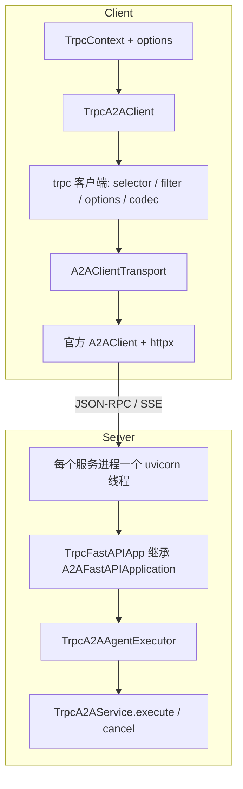

[English](README.md) | 中文

# tRPC-A2A-Python

`tRPC-A2A-Python` 是 trpc-python 框架对接 **A2A（Agent2Agent）** 协议的插件。它让你用 trpc 的方式实现和调用 Agent（消息、任务、流式更新、推送通知），并把 A2A 接入 trpc 的服务治理体系。

一句话概括：

```text
trpc-a2a = 官方 a2a-sdk（A2AFastAPIApplication / A2AClient）+ trpc-python 服务治理（selector / filter / options）+ trpc_fastapi（FastAPI & uvicorn）
```

服务端继承 `TrpcA2AService` 实现 Agent，由 trpc server 托管；客户端用 `TrpcA2AClient` 调用。JSON-RPC 与 SSE 仍由官方 a2a-sdk 收发，调用链路复用 trpc 的寻址、filter 与 options，接口形态与官方 SDK 保持一致。

## 核心特点

- **trpc 原生体验**：服务端实现 `get_agent_card` / `execute` / `cancel`，`register_service` 后随 `create_server().serve()` 启动；客户端按 YAML 里的 service name 发现 agent card 并调用。
- **复用官方 a2a-sdk**：服务端基于 `A2AFastAPIApplication`，客户端基于 `A2AClient`。消息、任务、SSE、agent card（`/.well-known/agent-card.json`）与官方类型、事件队列用法一致。
- **对接 trpc 服务治理**：客户端走 selector、filter、options（协议 / 超时 / 目标）。服务端请求先过 server filter；JSON-RPC method 记成 rpc name，协议错误转成 `TrpcException`，filter 能看到。
- **任务与推送可共享**：默认把 task 和推送配置放在进程内存。配置 `redis_name` 后改用 Redis，多进程下 `tasks/get`、`tasks/cancel` 和推送配置可以打到任意进程。
- **同端口自定义 HTTP**：`@fastapi_route` 或 `set_fastapi` 把业务路由挂在同一个端口上，处理函数里用 `get_trpc_ctx()` 读 tRPC 上下文。
- **流式与推送**：`send_message_streaming` / `resubscribe` 走 SSE；`pushNotifications` 由官方 `TaskUpdater` 在状态和 artifact 更新时触发 webhook。

## 安装与快速开始

### 环境要求

- Python `>=3.10`（推荐 3.12），建议用虚拟环境隔离依赖。
- trpc-python SDK（`trpc_sdk` 包，PyPI 名 `trpc-python`），不支持 Windows。

### 安装

```bash
pip install trpc-a2a
```

依赖：`trpc-python`、`trpc_fastapi`、`a2a-sdk>=0.3.5`、`fastapi`、`uvicorn`、`httpx`。

多进程共享 task，或需要把推送配置放到 Redis 时，安装 redis 扩展（额外安装 `redis` 和 `trpc_redis`）：

```bash
pip install 'trpc-a2a[redis]'
```

没配 `redis_name` 时使用进程内存储，不会加载 `trpc_redis`。配了 `redis_name`、对应的 client service 也存在、但没装扩展时，启动抛 `ImportError`，并提示执行上面的安装命令。

### 快速开始

#### 1. 服务端：实现 Agent 并启动

`trpc_python.yaml`：

```yaml
server:
  service:
    - name: trpc.a2a_test.test_a2a_agent
      protocol: a2a          # 协议固定为 a2a
      ip: 127.0.0.1          # 会写入 agent card 的 url，客户端按这个地址发 JSON-RPC
      port: 18080
      network: tcp
      # 如果需要使用 Redis，取消注释以下配置
      # redis_name: trpc.redis.test_example

# 如果需要使用 Redis，添加以下配置
# client:
#   service:
#     - name: trpc.redis.test_example
#       target: ip://127.0.0.1:6379
#       timeout: 5000
#       password: ${redis_password}  # 可选
#       redis:
#         db: 0
```

```python
# agents/echo_agent.py
from trpc_sdk.abc import TrpcContext

from a2a.server.events import EventQueue
from a2a.server.tasks import TaskUpdater
from a2a.types import AgentCapabilities, AgentCard, AgentSkill, Part, TaskState, TextPart
from a2a.utils import new_agent_text_message, new_task

from trpc_a2a.server import TrpcA2AService, get_a2a_request_context, register_service


class EchoAgentService(TrpcA2AService):
    async def get_agent_card(self) -> AgentCard:
        return AgentCard(
            name="Echo Agent",
            description="A simple echo agent",
            url="",  # 留空则填成上面的 ip:port
            version="1.0.0",
            default_input_modes=["text"],
            default_output_modes=["text"],
            capabilities=AgentCapabilities(streaming=False, pushNotifications=False),
            skills=[AgentSkill(id="echo", name="Echo", description="Echo the user text", tags=["echo"])],
        )

    async def execute(self, context: TrpcContext, event_queue: EventQueue) -> None:
        a2a_context = get_a2a_request_context(context)
        task = a2a_context.current_task or new_task(a2a_context.message)
        await event_queue.enqueue_event(task)
        updater = TaskUpdater(event_queue, task.id, task.context_id)
        text = a2a_context.get_user_input()
        await updater.add_artifact([Part(root=TextPart(text=f"You said: {text}"))], name="response")
        await updater.complete()

    async def cancel(self, context: TrpcContext, event_queue: EventQueue) -> None:
        a2a_context = get_a2a_request_context(context)
        task = a2a_context.current_task
        if not task:
            return
        updater = TaskUpdater(event_queue, task.id, task.context_id)
        await updater.update_status(
            TaskState.canceled,
            new_agent_text_message("cancelled", task.context_id, task.id),
            final=True,
        )


register_service("trpc.a2a_test.test_a2a_agent", EchoAgentService())
```

```python
# trpc_main.py
from trpc_sdk.server import create_server

import agents.echo_agent as _  # import 时执行 register_service，必须早于 create_server

create_server("trpc_python.yaml").serve()
```

启动：

```bash
python trpc_main.py --conf trpc_python.yaml
```

#### 2. 客户端：发现 agent card 并发送消息

纯客户端进程要先加载配置并初始化插件。服务端进程里已经 `serve()` 过则不用再做这两步。

```yaml
client:
  service:
    - name: trpc.a2a_test.test_a2a_agent
      protocol: a2a
      target: ip://127.0.0.1:18080
      timeout: 10000          # 毫秒
```

```python
from uuid import uuid4

from a2a.types import Message, MessageSendParams, Part, Role, SendMessageRequest, TextPart
from trpc_sdk.abc import TrpcContext
from trpc_sdk.client import Options
from trpc_sdk.config import TrpcConfig
from trpc_sdk.plugin import init_plugins

from trpc_a2a.client import TrpcA2ACardResolver, TrpcA2AClient

TrpcConfig.load("trpc_python.yaml", "utf-8")
init_plugins()

ctx = TrpcContext()
resolver_result = await TrpcA2ACardResolver().get_from_agent_service(ctx, "trpc.a2a_test.test_a2a_agent")
client = TrpcA2AClient(service_name="trpc.a2a_test.test_a2a_agent", resolver_result=resolver_result)

message = Message(role=Role.user, message_id=str(uuid4()), parts=[Part(root=TextPart(text="hello"))])
request = SendMessageRequest(id=str(uuid4()), params=MessageSendParams(message=message))
response = await client.send_message(ctx, request)

# 单次调用的超时（毫秒），后写的 options 覆盖默认值
response = await client.send_message(ctx, request, options=Options().set_timeout(3000))
```

不读 YAML、直接连一个 URL 时，用 `get_from_agent_url(ctx, "http://127.0.0.1:18080")`。这时客户端会把协议设成 `a2a`，默认超时 10 秒，并把 card 的 `url` 转成 `ip://host:port` 作为 target。

> 文本收发、流式与取消、多轮对话、推送通知、错误处理、直连 URL，以及五种进程模型的可运行示例和一键脚本见 **[`examples/README.md`](examples/README.md)**。脚本是 [`examples/run_examples.sh`](examples/run_examples.sh)。

## 整体设计

客户端调用走 trpc 客户端治理链路，真正的 JSON-RPC / SSE 由官方 `A2AClient` 发到 agent card 的 `url`。服务端是继承官方 `A2AFastAPIApplication` 的 FastAPI 应用，由 `trpc_fastapi` 在每个服务进程里用 uvicorn 托管。



要点：

- **客户端**：`TrpcA2AClient` 把一次调用封装成 trpc `invoke`。selector、filter、超时和 codec 在这一层生效。传输插件拿到官方 `A2AClient` 后，由 a2a-sdk 用 httpx 把 JSON-RPC 或 SSE 发到 agent card 的 `url`。因此 card 上的地址必须是调用方能够访问的地址。
- **发现**：`get_from_agent_service` 用该 service 的 trpc HTTP 客户端去拉 `/.well-known/agent-card.json`，寻址以 YAML 的 `target` 为准。`get_from_agent_url` 直接 GET 这个 URL。
- **服务端**：`import trpc_a2a` 时通过 `register_protocol_to_fastapi("a2a")` 把协议交给 trpc_fastapi。Worker 插件 `setup_a2a_agent` 在每个服务进程里为已注册的 service 构建 FastAPI app，再由 `start_fastapi` 起一个 uvicorn 线程。请求先经过 trpc server filter，再进入 A2A 路由。
- **上下文**：uvicorn 线程里用 `get_trpc_ctx()` 拿到 `TrpcContext`，放进 A2A `ServerCallContext`。`execute` / `cancel` 收到的是 `TrpcContext`，用 `get_a2a_request_context` 取回官方 `RequestContext`（用户输入、当前 task、task id）。

## 使用方式

### 服务端 TrpcA2AService

继承 `TrpcA2AService` 并实现三个方法，然后按 YAML 里的 service name 注册。三个方法都是抽象方法，缺一个类无法实例化。

- `async get_agent_card(self) -> AgentCard`
- `async execute(self, context: TrpcContext, event_queue: EventQueue) -> None`
- `async cancel(self, context: TrpcContext, event_queue: EventQueue) -> None`

`register_service(service_name, service)` 必须在 `create_server` 之前执行。重复注册同一个名字会抛 `ValueError`。YAML 里有 `protocol: a2a` 但没有对应注册时，启动打 warning，这个 service 不会对外提供 A2A。

`execute` 里用官方 SDK 推进任务：`new_task`、`TaskUpdater.update_status` / `add_artifact` / `complete`，状态用 `TaskState`（`working`、`input_required`、`completed`、`canceled`、`failed` 等）。`get_a2a_request_context(context)` 返回官方 `RequestContext`，常用字段是 `get_user_input()`、`current_task`、`task_id`、`message`。

`AgentCard.url` 留空时，启动填成 `http://{ip}:{port}`。`ip` 为空且配置了 `address` 时用 `address`。客户端随后按这张 card 的 `url` 发请求，所以这里要写成客户端能访问的地址。

同一个端口上的普通 HTTP：

- `@fastapi_route(path, methods, route_params=)` 注册路由，在 `async def` 里调用 `get_trpc_ctx()`。
- `service.set_fastapi(app)` 传入自己的 `FastAPI` 实例，A2A 路由会挂到这个 app 上。

示例里的 Basic Agent 另外挂了 `GET /hello`，返回 `remote_ip`。

### 客户端 TrpcA2AClient

构造：`TrpcA2AClient(service_name, resolver_result, interceptors=None, httpx_client=None)`。

`resolver_result` 来自 `TrpcA2ACardResolver`：

- `get_from_agent_service(ctx, service_name)`：按 YAML 寻址，适合通过 YAML `target` 做服务发现与寻址。
- `get_from_agent_url(ctx, agent_url)`：直连 URL。可选 `agent_card_path`，默认 `/.well-known/agent-card.json`。

常用方法：`send_message` / `send_message_streaming` / `get_task` / `cancel_task` / `set_task_callback` / `get_task_callback` / `resubscribe` / `get_card`。参数和返回值与官方 `A2AClient` 对应，第一个参数换成 `TrpcContext`。

- `options` 是 `trpc_sdk.client.Options`（或返回它的 callable）。客户端先放入自己的默认项，再接用户传入的项，后写覆盖。按 service 发现时，协议、target、超时来自 YAML；按 URL 发现时，默认 `protocol=a2a`、超时 10 秒、target 取自 card 的 `url`。
- `http_kwargs` 传给底层 httpx。未指定 `timeout` 时，用本次 trpc 上下文的超时（秒）；超时小于等于 0 时不限制。
- 官方 `ClientCallContext`（拦截器等）用 `set_a2a_client_context(ctx, client_context)` 放进 `TrpcContext`，调用时自动取出。`get_a2a_client_context` 做反向读取。
- `interceptors` 是官方 `ClientCallInterceptor` 列表。`httpx_client` 可传入自己的 `httpx.AsyncClient`，否则传输层按 service 懒创建一个。

流式方法返回异步生成器，元素是 `Task`、`Message`、`TaskStatusUpdateEvent` 或 `TaskArtifactUpdateEvent`。JSON-RPC 错误和 `A2AClientError` 都会转成 `TrpcException`。

### 配置

协议名固定是 `a2a`。服务端和客户端的 service name 要一致。

多进程共享 task 与推送配置时，在 **server service** 上写 `redis_name`，并在 **client.service** 里提供同名的 Redis 后端。`redis_name` 能对上 client service 时才启用 Redis；对不上则仍用进程内存。

```yaml
server:
  service:
    - name: trpc.a2a_test.test_a2a_agent
      protocol: a2a
      ip: 127.0.0.1
      port: 18080
      network: tcp
      redis_name: trpc.redis.test_example
      # task_key_prefix: a2a:tasks:                      # 默认 a2a:tasks:
      # notification_key_prefix: a2a:push_notifications: # 默认 a2a:push_notifications:

client:
  service:
    - name: trpc.redis.test_example
      target: ip://127.0.0.1:6379
      timeout: 5000
      ttl: 3600                 # task 与推送配置的过期秒数，默认 3600
      password: ${redis_password}
      redis:
        db: 0
```

`ttl`、`task_key_prefix`、`notification_key_prefix` 由本插件从原始 YAML 读取。`target`、`password`、`redis.db` 交给 `trpc_redis`。

## 进程/线程模型

进程模型由框架 YAML 的 `global.processmodel` 决定。A2A 端口由 trpc_fastapi 托管：**每个服务进程构建一次 FastAPI app，每个 `a2a` 地址一个 uvicorn**。uvicorn 跑在 daemon 线程里，用 `SO_REUSEPORT` 绑定该进程负责的地址。

| 模型 | YAML | A2A/uvicorn 在哪 |
|---|---|---|
| merge 单 loop（默认） | 不配 `processmodel` | 主进程 1 个 |
| merge 多线程 | `mode: single_process`，`handle_num` > 1 | 主进程 1 个（由第 0 个 serving 线程启动，其他线程不重复起） |
| separate | `mode: multi_process`，`io_handle_type: separate`，`handle_num: N` | 每个 rpc task 进程 1 个；I/O 进程不监听 `a2a` 端口 |
| peer | `mode: multi_process`，`io_handle_type: peer`（或 `merge`），`handle_num: N` | 每个对等 worker 进程 1 个 |

```yaml
global:
  processmodel:
    mode: multi_process
    io_handle_type: separate
    handle_num: 2          # 0 表示 CPU 核数
```

示例里的五份配置见 [`examples/README.md`](examples/README.md)：`trpc_python.yaml`、`trpc_python_single_process_merge.yaml`、`trpc_python_single_process_separate.yaml`、`trpc_python_multi_process_separate.yaml`、`trpc_python_multi_process_merge.yaml`。`examples/run_examples.sh modes` 用 basic 客户端对每份配置各跑一遍。

**多进程与 task 状态**：`mode: multi_process` 且进程数大于 1 时，若该 service 没有解析到 `redis_name`，启动会打 warning，并继续按配置的进程数跑。task 和推送配置留在进程内存里，`tasks/get` 和 `tasks/cancel` 可能打到没见过该任务的进程。Agent 自己放在进程里的会话（例如多轮示例里的答题进度）也不会跟着 Redis task 一起共享，那种状态需要业务自己外置。merge 模式只有一个进程，不受这个限制。

**优雅退出**：收到 SIGTERM 后，框架的 `exit_callbacks` 让 uvicorn 停止接收新连接并开始 graceful shutdown。超时取框架的 drain 时间（`server.close_wait_time`，毫秒）。`post_drain_callbacks` 再等待 uvicorn 线程结束（drain 时间 + 2 秒，超时打 warning）。


## 注意事项

- **协议**：服务端与客户端的 `protocol` 都用 `a2a`。
- **agent card 的 url**：客户端的 JSON-RPC 发往 card 上的 `url`，YAML 里的 `target` 用来发现 card 以及走 trpc 治理链路。`ip` 写成 `0.0.0.0` 时，card 的 url 也会是 `http://0.0.0.0:port`，调用方连不上去。需要对外访问时写成可达地址，或在 `get_agent_card` 里自己填 `url`。
- **注册时机**：`register_service` 写在模块顶层，`trpc_main.py` 在 `create_server` 之前 import 该模块。多个 agent 注册同一个 service name 会在 import 时失败，一次只导入一个实现。
- **Redis**：`redis_name` 必须等于某个 `client.service[].name`。只在 server service 上写了名字、client 侧没有同名服务时，插件按内存存储运行，不会报错。
- **推送**：`AgentCapabilities` 里打开 `pushNotifications` 后，用 `TaskUpdater` 更新状态或 artifact 即会按官方 SDK 规则向 webhook 推送。客户端在 `MessageSendConfiguration` 里带 `PushNotificationConfig`，`blocking=False` 时 `send_message` 提交后返回，后续更新走 webhook。
- **流式**：服务端 `streaming=True`，并用 `update_status` 持续推进度。客户端用 `send_message_streaming` 消费 SSE。断线后用 `resubscribe` 接回同一任务的更新。

## 目录参考

- `trpc_a2a/server/a2a_service.py`：`TrpcA2AService` 基类。
- `trpc_a2a/server/a2a_registry.py`：`register_service` 与按 service name 索引的注册表。
- `trpc_a2a/server/trpc_agent_executor.py`：官方 `AgentExecutor` 与 `TrpcA2AService` 之间的适配，负责两边上下文的放入和取出。
- `trpc_a2a/server/trpc_fastapi_app.py`：`TrpcFastAPIApp`（继承 `A2AFastAPIApplication`），选择内存或 Redis 存储，并在 `tasks/cancel` 时带上 call context。
- `trpc_a2a/server/_trpc_fastapi_adapter.py`：把协议 `a2a` 交给 trpc_fastapi；Worker 插件构建 app；请求前回填 rpc name，响应后把 JSON-RPC 错误转成 `TrpcException`。
- `trpc_a2a/server/utils.py`：`get_a2a_request_context` / `set_a2a_request_context`。
- `trpc_a2a/server/redis_conf.py`：从 YAML 解析 `redis_name`、ttl 和 key 前缀。
- `trpc_a2a/server/redis_task_store.py` / `redis_push_notification_config_store.py`：Redis 上的 task 与推送配置。
- `trpc_a2a/client/a2a_client.py`：客户端 `TrpcA2AClient`。
- `trpc_a2a/client/a2a_card_resolver.py`：按 service name 或 URL 拉取 agent card。
- `trpc_a2a/client/a2a_transport.py`：`a2a` 客户端传输，按 service 持有官方 `A2AClient`。
- `trpc_a2a/client/codec.py`：`a2a` 客户端 codec。请求体在 message head 上传递，codec 只做透传。
- `trpc_a2a/client/request.py` / `utils.py`：官方方法分发，以及 `ClientCallContext`、错误码转换。
- `examples/`：完整可运行示例，见 [`examples/README.md`](examples/README.md)。

## 常见问题

### 客户端 `protocol` 配成 `http` 可以吗？

服务端和按 service 发现的客户端都用 `a2a`。协议决定走哪套 codec 和传输。配成 `http` 时，这次调用不会进入 `A2AClientTransport`。按 URL 发现时，`TrpcA2AClient` 会自己补上 `protocol=a2a`，仍建议在 YAML 里写明。

### 多进程下 `tasks/get` 或 `tasks/cancel` 为什么找不到任务？

separate / peer 用 `SO_REUSEPORT` 把连接分到不同进程。没配 `redis_name` 时，task 只存在于处理 `message/send` 的那个进程里，后续查询和取消可能进了别的进程。给该 service 配上 `redis_name`，并安装 `trpc-a2a[redis]`。启动日志里如果有 `without 'redis_name'` 的 warning，就是这个情况。

### 已经写了 `redis_name`，为什么还是进程内存？

`redis_name` 要和某个 `client.service[].name` 完全一致，插件才启用 Redis。只写在 server service 上、client 侧没有同名服务时，解析结果是空的，存储退回内存，启动不会因此失败。名字对上了但没装扩展，则会在创建 Redis 客户端时抛 `ImportError`。

### agent card 能拉到，发消息却连不上？

拉 card 走的是 YAML `target`（或 `get_from_agent_url` 的参数）。发消息走的是 card 里的 `url`。服务端 `url` 留空时，填进去的是配置的 `ip:port`。`ip` 是 `0.0.0.0`，或是客户端访问不到的网卡地址时，card 能发现，JSON-RPC 会连失败。把 `ip` 改成客户端能访问的地址，或在 `get_agent_card` 里显式设置 `url`。

